# 【第十週作業繳交報告】用 LLM Wiki 做一份教學 HTML 簡報

> **繳交標題格式**：臺灣大學 學號 系級 姓名 視覺導引機器手臂：從眼睛到大腦的智慧協調  
> **作業主題**：視覺導引機器手臂（Vision-Guided Robotic Manipulators）零基礎教學  
> **繳交日期**：2026 年 11 月 15 日  

---

## 1. LLM Wiki 主題與簡短介紹

### 🎯 主題定位
本作業選定主題為**「視覺導引機器手臂（Vision-Guided Robotic Manipulators）」**。目標受眾鎖定在**「完全沒有機械、控制或人工智慧背景的零基礎初學者」**。

### 📖 核心內容簡述
傳統工業機器手臂本質上是「盲人」，只能日復一日重複執行預先寫死的固定軌跡，一旦零件位置稍有偏差便會夾空或撞機。為了解決此痛點，現代機器人學融合了「電腦視覺」與「控制工程」，打造出具備「眼-腦-手」協調運作能力的智慧手臂系統。

本 Wiki 精煉自 7 篇聚焦於此領域的代表性碩士學位論文，捨棄了艱澀的純數學推導與繁複文獻，將系統提煉為三步驟核心問題：
1. **眼睛（感官）**：我看到了什麼？（目標辨識與分類）
2. **大腦（決策）**：它在三維空間哪裡？若在移動，幾秒後會在哪裡？（深度感知、手眼座標轉換、卡爾曼軌跡預測、主動視角探索）
3. **骨骼與手（控制）**：關節該怎麼轉、加速度如何平滑才不會手震？（正逆運動學、梯形加減速、三次多項式內插避震）

---

## 2. LLM Wiki 成果說明與檔案架構

Wiki 採用**「1 份總覽索引 + 3 份循序漸進主題模組」**架構，嚴謹落實「來源隔離」，所有內容皆有明確的論文依據與跨章節超連結：

### 🗂️ 檔案目錄與對應論文

* 📄 **[index.md](./llm_wiki/index.md)（知識庫導讀與全景地圖）**
  * 內容重點：機器人「靈魂三問」、7 篇核心文獻對照全景表、初學者術語速查庫（DOF、TCP、PBVS、SLAM 等）。
  * 對應論文：全部 7 篇論文整合導讀。
* 📄 **[01_mechanics_and_kinematics.md](./llm_wiki/01_mechanics_and_kinematics.md)（【基礎篇·骨骼與肌肉】機器手臂如何看懂指令並優雅運動？）**
  * 內容重點：四軸 vs. 六軸機構自由度（DOF）；CAD/CAE（ADAMS）極限扭力動態模擬；眼在手（Eye-in-Hand）vs. 眼到手（Eye-to-Hand）優劣對決；正向與逆向運動學幾何解（耗時 < 1ms）；位置基準視覺伺服（PBVS）；梯形速度曲線與三次多項式內插避震。
  * 對應論文：`[文獻 2, 5, 6, 7]`。
* 📄 **[02_vision_and_depth_perception.md](./llm_wiki/02_vision_and_depth_perception.md)（【感官篇·眼睛與距離】從平面到立體：3D 視覺與動態追蹤）**
  * 內容重點：雙目立體視差 vs. 相似三角形幾何法 vs. RGB-D 主動式深度相機；**500mm 深度量測黃金分界律**（<500mm 幾何法誤差 1~4mm，>500mm 深度鏡頭成功率 100%）；張正友棋盤格相機標定；單應性平面座標轉換（耗時 0.001ms）；YOLOv10 即時分類 + 目標鎖定防抖；二維等速度卡爾曼濾波器（Kalman Filter）預測未來落點抗延遲與遮擋。
  * 對應論文：`[文獻 1, 2, 6, 7]`。
* 📄 **[03_advanced_intelligence_and_evaluation.md](./llm_wiki/03_advanced_intelligence_and_evaluation.md)（【大腦篇·自主與精準】主動探索 AI 與高精度定位評估）**
  * 內容重點：雜亂堆疊場景下被動視覺的遮擋與點雲缺洞致命傷；主動視覺（Active Perception）與 A3C 深度強化學習；**GTAM 門控時序注意力**與**潛在特徵記憶（Latent-Feature Memory）**（徹底取代幾百萬點雲暴力拼接）；ISO 9283 位姿準確度（AP）與重複精度（RP）工業規範；臺大跨界創新：以 2D LiDAR Cartographer SLAM 達成 **0.0353 mm 超高精度**，成本降低兩個數量級（1/100 成本）。
  * 對應論文：`[文獻 1, 3, 4]`。

---

## 3. 教學 HTML 簡報特色與瀏覽說明

* 🔗 **簡報成果檔案**：📄 **[presentation.html](./output/presentation.html)**

### 🌟 簡報核心特色
1. **100% 零外部依賴（Zero-Dependency Standalone）**：完全不依賴任何外部 CDN 或網路字體庫，單一檔案離線雙擊即可於任何現代瀏覽器中極速運行。
2. **現代科技感全螢幕視口設計（100vw × 100vh）**：
   * 採用深色賽博工程風格配色（`#0a0e17` 深色底、`#38bdf8` 霓虹藍亮色強調），資訊層次分明。
   * **左右雙欄卡片佈局**：左側為「💡 生活化比喻與情境」，右側為「⚙️ 核心技術原理解析與量化實證卡片」，底部配置「🎯 一秒帶走結論（Key Takeaway）」橫幅。
   * **響應式排版**：內建 `@media (max-width: 900px)` 自適應規則，在窄螢幕、平板或投影機上自動調整為流暢單欄排版，完全無文字溢出（Overflow）與水平捲軸。
3. **全功能交互導覽**：
   * 支援鍵盤按鍵：`←`（上一頁）、`→` / `Space`（下一頁）、`PageUp` / `PageDown`、`Home` / `End`。
   * 畫面右下角配置「◀ 上一頁」與「下一頁 ▶」按鈕，並於第 1 頁與第 8 頁自動鎖定（`disabled`）。
   * 畫面頂部設有平滑動態進度條（`12.5%` ~ `100%`），右上角顯示即時頁碼計數器（如 `1 / 8`）。
   * 底部頁腳動態同步標註每張投影片對應的 **Wiki 來源檔名** 與 **`[文獻 X]` 編號**。

---

## 4. Loop / Graph 的流程圖與機制說明

### 🔄 系統架構流程圖（Mermaid Graph）

```mermaid
flowchart TD
    subgraph Phase1["【Phase 1】文獻研讀與 Wiki 構建迴圈"]
        A["7 篇原始論文 PDF (raw_sources/)"] --> B["論文精煉與概念提取 (略過文獻與純數學)"]
        B --> C{"人機架構討論閘門 (Human Approval Gate)"}
        C -- "提出 1+3 檔案規劃" --> D["使用者審核架構"]
        D -- "同意架構" --> E["生成 llm_wiki/ 4 份主題筆記"]
        E --> F["步驟 A：Wiki 局部修補 (Surgical Patch)"]
        F --> G["Wiki 完備，啟動【嚴格來源隔離】"]
    end

    subgraph Phase2["【Phase 2】教學簡報大綱 Shift-Left 自我檢查迴圈"]
        G --> H["讀取 llm_wiki/ (嚴禁接觸 raw_sources/)"]
        H --> I["生成初版教學大綱 (Outline v1, 8 頁)"]
        I --> J{"【Loop 1】教學助教審查閘門 (Pedagogical TA Gate)"}
        J -- "抓出術語過深 / 缺實證數據 / 延遲盲點" --> K["判定退回 (REJECTED)"]
        K --> L["重構改寫為 v2 大綱 (生活比喻 + 實證錨點)"]
        L --> M{"使用者大綱確認閘門 (Pause Point)"}
        M -- "同意大綱" --> N["進入 Phase 3"]
    end

    subgraph Phase3["【Phase 3】HTML 簡報編譯與視覺驗收迴圈"]
        N --> O["編譯獨立單檔 presentation.html (零外部依賴)"]
        O --> P{"【Loop 2】自動化瀏覽器視覺驗收閘門 (Browser Visual Gate)"}
        P -- "抓出水平捲軸 / raw LaTeX / 窄螢幕頁腳折行" --> Q["執行前端修復 (clamp 字級 / 語意 HTML / media query)"]
        Q --> R["瀏覽器二次驗收通過 (PASSED)"]
        R --> S["更新 audit_trace.md 完整紀錄"]
        S --> T["輸出作業繳交報告 (submission_report.md)"]
    end

    classDef gate fill:#f59e0b,stroke:#d97706,stroke-width:2px,color:#fff;
    classDef reject fill:#ef4444,stroke:#b91c1c,stroke-width:2px,color:#fff;
    classDef pass fill:#10b981,stroke:#047857,stroke-width:2px,color:#fff;
    class C,D,J,M,P gate;
    class K reject;
    class R,T pass;
```

### ⚙️ 流程機制深入解析

#### 1. 哪些步驟會重複執行？
* **Loop 1（教學大綱審查迴圈）**：初版大綱（v1）生成後，並不直接推進至寫程式碼，而是由扮演「嚴格教學助教」的角色啟動檢驗。若發現專業黑話過多、缺乏初學者比喻或論文數據支撐，便觸發**「退回重寫（Reject & Rewrite）」**，直到 v2 大綱完全符合零基礎教學標準。
* **Loop 2（瀏覽器視覺驗收迴圈）**：在 `presentation.html` 編譯完成後，啟動背景本機伺服器與瀏覽器子代理人（Browser Inspector Subagent），實地遍歷 8 頁投影片的點擊交互、不同視窗寬度排版與鍵盤響應。若偵測到文字超出邊界、未渲染標籤或排版擁擠，立即觸發**「樣式微調與再檢驗」**，直到全視口無任何水平捲軸為止。

#### 2. 哪些地方需要檢查或重新生成？
* **架構共識點（Human-in-the-Loop Gate 1）**：在 Phase 1，嚴格遵守「先討論、後生成」原則，在獲得使用者明確回覆「同意架構」前，絕對不預先建立 `.md` 檔案。
* **大綱審查點（Pedagogical Shift-Left Gate）**：在大綱階段即檢核術語難度，避免將「單應性矩陣」、「雅可比奇異點」或「A3C 強化學習」生硬移植到投影片上。
* **視覺檢查點（Visual Inspection Gate）**：檢核預格式化 ASCII 圖解在窄螢幕下的換行行為，以及原始 LaTeX 符號在無外聯 CDN 環境下的渲染相容性。

#### 3. 為什麼這樣設計？
* **落實「檢查左移（Shift-Left）」原則**：在軟體工程與內容生成中，**在大綱階段修正一個架構或邏輯缺陷的成本，遠比在數百行 HTML/CSS 寫完後推倒重來的成本低 10 倍以上**。
* **嚴格實施「來源隔離」**：一旦 Wiki 建立完畢，簡報生成階段強制**只讀取 Wiki**，徹底切斷與原始 PDF 的直接存取。這確保了簡報內容 100% 來自於自己整理出的知識庫，避免大語言模型跳過知識庫直接猜測或產生幻覺。

---

## 5. 一次實際執行的結果與檢查紀錄

本作業之所有執行軌跡、審查意見與修復紀錄皆真實留存於 📄 **[audit_trace.md](./output/audit_trace.md)**。以下為關鍵執行成果精華：

### 🛠️ 1. Wiki 局部修補執行紀錄（Surgical Patch）
* **筆誤修正**：
  * 修復 `03_advanced_intelligence_and_evaluation.md` 第 75 行贅字「抽取的萃取特徵」➔「萃取特徵」。
  * 修復第 109 行疊字筆誤「測量立刻中斷中斷」➔「測量立刻中斷 `[文獻 3]`」。
* **檔案追溯補齊**：於 `index.md` 核心文獻表格中新增「原始檔案名稱 (`raw_sources/`)」一欄，精準對齊 7 篇 PDF 原檔。
* **標籤強化**：逐節補齊 `01`~`03` 各技術段落末尾之 `[文獻 X]` 引用，確保每一項宣稱皆有論文支撐。

### 🔄 2. 大綱檢查迴圈紀錄（Loop 1 Audit Trace）
* **v1 大綱被抓出的三大教學盲點**：
  1. *黑話堆疊*：直接使用「逆運動學非線性解析」、「單應性矩陣快速映射」、「A3C 強化學習與消融實驗」作為投影片大標題，嚴重脫離零基礎初學者的理解能力。
  2. *缺少量化實證錨點*：遺漏了論文中極具震撼力的實驗數字（如 500mm 成功率 100%、SLAM 0.0353 mm 均方根誤差）。
  3. *未揭露物理時序延遲*：未點出「相機拍照處理要時間（30ms）、手臂運動也要時間」的累積延遲現實，使學生無法體會為何非得用卡爾曼濾波器做「未來落點預判」。
* **修正結果（v2 大綱）**：
  * 主標題全面改用生活化提問（如：「手肘該彎幾度？」、「告別手震與急煞」、「精準預言家」）。
  * 引入「肩膀手肘」、「老司機開車」、「接外野高飛球」、「抽屜找鑰匙」、「射箭看準度與精度」五大生活比喻。
  * 每頁強制標註核心比喻、機制解析、量化實證、Key Takeaway 與文獻註腳。

### 🖥️ 3. 簡報視覺驗收紀錄（Loop 2 Visual Audit）
由自動化瀏覽器子代理人（Browser Inspector Subagent）在 `http://localhost:8080/presentation.html` 完成實機檢測：
* **導覽驗證**：按鈕鎖定邏輯（首頁無上一頁、末頁無下一頁）、方向鍵/空白鍵切換、進度條（12.5%~100%）、計數器（1/8~8/8）及文獻註腳動態更新，功能皆為 100% 正常。
* **視覺瑕疵修復**：
  * *瑕疵 1*：ASCII 圖解在視窗小於 850px 時產生水平捲軸。➔ **修正**：將 `.diagram-panel` 調整為 `font-size: clamp(10px, 1vw, 11.5px)` 並加上 `white-space: pre-wrap; word-break: break-word`。
  * *瑕疵 2*：無 KaTeX 環境下裸露 raw LaTeX（`$Z$`、`$s(t) = ...$`）。➔ **修正**：改寫為標準語意化 HTML 標籤（`<em>Z</em>`、`<em>s</em>(<em>t</em>) = <em>a</em>0...`）。
  * *瑕疵 3*：視窗寬度小於 900px 時雙欄卡片與頁腳擠壓。➔ **修正**：新增 `@media (max-width: 900px)` 響應式斷點，自適應轉換為單欄垂直佈局。
  * *瑕疵 4*：原始碼殘留 Markdown 星號 `**`。➔ **修正**：全面轉為 `<strong>` 語意標籤。
* **最終判定**：全視口通過驗收（**PASSED**）。

---

## 6. 工程反思（Engineering Reflections）

### 🧐 1. 哪一個節點最常出錯？
回顧整個實作歷程，最容易出錯的節點並非「編寫程式碼」，而是**「跨領域概念的降維轉譯節點（Cross-Domain Pedagogical Translation）」**。

* **問題本質**：當大語言模型消化了大量高密度的學術論文後，很容易在後續生成簡報大綱時，**「無意識地退回專業黑話的舒適圈」**。模型往往會直覺地將「單應性矩陣（Homography）」、「雅可比奇異點（Singularity）」或「A3C 非同步演員評論家網路」原封不動貼上簡報。
* **教學後果**：對於沒有微積分、線性代數與機器人學背景的初學者而言，這些詞彙會直接築起一道知識高牆，徹底失去「教學型簡報」的初衷。

### 🚀 2. 你發現問題後，把檢查往前移（Shift-Left）到了哪一個步驟？
我將原本在「HTML 程式碼撰寫後」才進行的教學品質檢查，**大幅前移到了「Phase 2 的大綱階段（Outline Inspection Gate, Loop 1）」**。

* **傳統做法的缺點**：如果等到 HTML、CSS 和 JavaScript 都切好排版後，才發現內容太艱深或學生看不懂，此時修改牽一髮動全身——不僅要重寫文字，還得重新調整 CSS 卡片高度、DOM 節點結構與腳本。
* **Shift-Left 的巨大優勢**：在「純文字大綱階段」就導入「嚴格教學助教」角色進行把關，要求每一頁必須強制填寫「生活化比喻」與「白話結論」。在這個階段退回重寫（v1 ➔ v2），**僅花費極小的文字重構成本，就徹底解決了專業門檻過高的核心問題**。

### 📐 3. 你有沒有因此修改 Workflow / Graph？為什麼？
**有，我將原本單向線性的工作流，徹底重構成為「雙重閉迴路閘門圖（Dual-Loop Gated Graph）」**：

1. **增設 Loop 1（大綱教學邏輯迴圈）**：原本的流程只規劃了「產生大綱 ➔ 產生簡報」。我在此處插入了一個條件分支節點 `Pedagogical TA Gate`，只有在大綱通過「白話轉譯檢驗」與「論文實證錨點檢驗」後，才被允許進入編譯階段。
2. **增設 Loop 2（前端無依賴視覺驗收迴圈）**：原本預期 HTML 產生後即完成任務。但考慮到作業要求「100% 零外部依賴」，外部常見的渲染引擎（如 CDN 上的 MathJax 或 Tailwind）無法使用。因此在圖中新增了「自動化瀏覽器視覺驗收節點」，確保在真實瀏覽器渲染下，消除所有溢出（Overflow）與字型相容性問題。
3. **為什麼這樣修改？**
   這樣的 Workflow 改造體現了現代 Agentic AI 系統的核心精神——**「不依賴運氣，而是依賴架構保證品質」**。透過明確的檢驗閘門與回溯機制，將資訊取得、降維整理、教學轉譯到最終視覺呈現的每一步驟，都鎖定在高品質的工程標準之上！
